  <!-- ✦ 1. Claude-Inspired Dynamic Motion Hero Banner -->
  

  <!-- ⌨️ 2. Dynamic Terminal Typing SVG (Warm Terracotta & Obsidian Palette) -->
  

  <!-- 🏷️ 3. Editorial Metrics & Status Pills -->
  

    
    
    
    
    
  

<!-- ✦ Claude Motion Terracotta Divider -->

---

## ✦ Executive Profile & Architectural Ethos

I am <strong>Mahfuz Hasan</strong>, a full-stack software architect specializing in the design and delivery of modern distributed web platforms, high-throughput microservices, and AI-augmented developer workflows.

My engineering philosophy is rooted in <strong>Claude-inspired editorial minimalism</strong>: stripping away extraneous complexity to produce systems characterized by <strong>strict type rigor</strong>, <strong>sub-second P95 latencies</strong>, and <strong>bulletproof concurrency safety</strong>. Whether structuring multi-tenant RBAC permissions or orchestrating autonomous agent loops, I build software that scales reliably under production load.

### ⚜️ Strategic Focus & Core Initiatives:
- 🏢 **Production Distributed Systems:** Architecting peer-to-peer marketplaces and booking platforms with **Next.js 16 (App Router)**, **React 19**, and **Express/MongoDB** in [`StudioSpace`](https://github.com/mahfuzhasan2700/studiospace-client).
- 🛒 **Market Data & Intelligence:** Engineering real-time price indexes and grocery commodity trackers with **Next.js 16**, **Tailwind CSS v4**, and **MongoDB Atlas** in [`Bazar-Dor`](https://github.com/mahfuzhasan2700/Bazar-Dor).
- ⚡ **Reactive State Analytics:** Implementing habit metrics and live telemetry calculators with reactive states in [`Fit-Log`](https://github.com/mahfuzhasan2700/Assignment-6).
- 🤖 **Agentic AI & Tooling:** Developing autonomous multi-step reasoning agents and tool-calling execution pipelines in [`Perseus_AI`](https://github.com/mahfuzhasan2700/Perseus_AI).
- 🎯 **Trigonometric Physics Simulators:** Calculating projectile ballistics and vector trajectory arcs at 60FPS on canvas in [`artillery-laying-simulator`](https://github.com/mahfuzhasan2700/artillery-laying-simulator).
- 📬 **Direct Inquiries:** Available via [mahfuzhasan2700@gmail.com](mailto:mahfuzhasan2700@gmail.com) and on [LinkedIn](https://linkedin.com/in/mahfuzhasan2700).

 

<!-- ✦ Claude Motion Terracotta Divider -->

---

## 🏛️ Flagship Engineering Projects

<table width="100%">
  <thead>
    <tr align="left">
      <th width="30%">Platform &amp; Architectural Scope</th>
      <th width="26%">Technology Stack</th>
      <th width="28%">System Highlights &amp; Features</th>
      <th width="16%" align="center">Deployments</th>
    </tr>
  </thead>
  <tbody>
    <!-- Project 1: StudioSpace -->
    <tr>
      <td valign="top">
        <a href="https://studiospace-client-eight.vercel.app" target="_blank">
          <strong>🏢 StudioSpace</strong>
        </a>
         
        Enterprise peer-to-peer creative production workspace marketplace. Creators inspect real-time hourly availability, reserve soundstages/suites, and complete bookings with zero concurrency conflicts.
      </td>
      <td valign="top">
        
        
         
        
        
         
        
        
      </td>
      <td valign="top">
        • Claude-inspired editorial UX 
        • Real-time slot locking &amp; anti-double-booking 
        • Role-Based Access (Host, Member, Admin) 
        • Multi-service architecture (Vercel Prod)
      </td>
      <td align="center" valign="middle">
        
          
        
          
        
      </td>
    </tr>

    <!-- Project 2: Bazar-Dor -->
    <tr>
      <td valign="top">
        <a href="https://bazar-dor-perseus11.vercel.app/" target="_blank">
          <strong>🛒 Bazar-Dor (বাজার দর)</strong>
        </a>
         
        Commodity price intelligence platform providing everyday market item rates, multi-market rate comparisons, and transparent price disparity tracking across city hubs.
      </td>
      <td valign="top">
        
        
         
        
        
         
        
        
      </td>
      <td valign="top">
        • Daily verified commodity tracking 
        • Cross-bazar rate variance analytics 
        • Multi-provider OAuth (Google, GitHub, Email) 
        • Clean responsive UI in Bangla &amp; English
      </td>
      <td align="center" valign="middle">
        
          
        
      </td>
    </tr>

    <!-- Project 3: Fit-Log -->
    <tr>
      <td valign="top">
        <a href="https://fitlog-workouts.netlify.app/" target="_blank">
          <strong>⚡ Fit-Log Workout Analytics</strong>
        </a>
         
        High-performance workout logging and habit engineering engine built with strict TypeScript types, 5-lift daily caps, live training metrics, and milestone celebration cues.
      </td>
      <td valign="top">
        
        
         
        
        
      </td>
      <td valign="top">
        • Strict type-safe modular state 
        • Five-lift daily focused routine engine 
        • Real-time calorie and volume calculations 
        • Zero-lag client-side persistence
      </td>
      <td align="center" valign="middle">
        
          
        
      </td>
    </tr>

    <!-- Project 4: Perseus_AI -->
    <tr>
      <td valign="top">
        <a href="https://github.com/mahfuzhasan2700/Perseus_AI">
          <strong>🤖 Perseus_AI Agent Framework</strong>
        </a>
         
        Intelligent automation framework and LLM agent orchestration harness designed for autonomous task decomposition, tool sandboxing, and workflow pipeline execution.
      </td>
      <td valign="top">
        
        
         
        
        
      </td>
      <td valign="top">
        • Autonomous goal-seeking agent loop 
        • Sandboxed external tool integration 
        • Multi-agent message routing 
        • Structured telemetry &amp; trace logs
      </td>
      <td align="center" valign="middle">
        
      </td>
    </tr>

    <!-- Project 5: Artillery Laying Simulator -->
    <tr>
      <td valign="top">
        <a href="https://github.com/mahfuzhasan2700/artillery-laying-simulator">
          <strong>🎯 Artillery Laying Simulator</strong>
        </a>
         
        Mathematical physics simulation engine rendering ballistic 2D projectile dynamics, trigonometric elevation angles, and aerodynamic drag vectors on an interactive 60FPS canvas.
      </td>
      <td valign="top">
        
         
        
        
      </td>
      <td valign="top">
        • Classical Newtonian ballistics equations 
        • Real-time 60FPS vector trajectory paths 
        • Interactive barrel azimuth &amp; charge sliders 
        • Dynamic impact radius collision detection
      </td>
      <td align="center" valign="middle">
        
      </td>
    </tr>

    <!-- Project 6: Amar_Finance -->
    <tr>
      <td valign="top">
        <a href="https://github.com/mahfuzhasan2700/Amar_Finance">
          <strong>💰 Amar_Finance Ledger</strong>
        </a>
         
        Real-time wealth tracking and cash-flow ledger engine designed for personal financial clarity, multi-account ledger balancing, and dynamic expense classification.
      </td>
      <td valign="top">
        
        
         
        
      </td>
      <td valign="top">
        • Instant transactional reconciliation 
        • Cash inflow/outflow distribution curves 
        • Zero-latency reactive calculations 
        • Resilient localStorage persistence
      </td>
      <td align="center" valign="middle">
        
      </td>
    </tr>
  </tbody>
</table>

<!-- ✦ Claude Motion Terracotta Divider -->

---

## 🛠️ Technical Arsenal & Ecosystem

  
<b>✦ Interactive Technical Matrix</b>

  

 

<table width="100%">
  <tr>
    <td width="50%" valign="top">
      <h3 align="left">💻 Languages &amp; Core Runtimes</h3>
      

        
        
        
        
        
      

      <h3 align="left">🌐 Frontend Architecture &amp; UI Systems</h3>
      

        
        
        
        
        
      

    </td>
    <td width="50%" valign="top">
      <h3 align="left">⚙️ Backend, Auth &amp; Databases</h3>
      

        
        
        
        
        
      

      <h3 align="left">🧰 DevOps, Cloud &amp; Tooling</h3>
      

        
        
        
        
        
      

    </td>
  </tr>
</table>

<!-- ✦ Claude Motion Terracotta Divider -->

---

## 📊 Live GitHub Performance & Velocity

  <!-- Claude Warm Obsidian Stats Cards -->
  <table border="0">
    <tr>
      <td align="center" valign="middle">
        
      </td>
      <td align="center" valign="middle">
        
      </td>
    </tr>
  </table>

   

  <!-- Claude Warm Streak Stats -->
  

 

<!-- 🐍 Contribution Grid Snake Animation -->

  <h3>🐍 Contribution Grid Snake Stream</h3>
  <picture>
    <source media="(prefers-color-scheme: dark)" srcset="https://raw.githubusercontent.com/mahfuzhasan2700/mahfuzhasan2700/output/github-contribution-grid-snake-dark.svg">
    <source media="(prefers-color-scheme: light)" srcset="https://raw.githubusercontent.com/mahfuzhasan2700/mahfuzhasan2700/output/github-contribution-grid-snake.svg">
    
  </picture>

<!-- ✦ Claude Motion Terracotta Divider -->

---

<!-- 💭 Dynamic Quote -->

  
<b>💭 Engineering Philosophy</b>

  

---

## 📬 Connect &amp; Collaborate

  
I am open to discussions regarding full-stack architecture, distributed systems, open-source initiatives, and high-impact engineering roles.

  

    
    
    
    
    
  

<!-- ✦ 10. Claude-Inspired Motion Footer Banner -->

  

